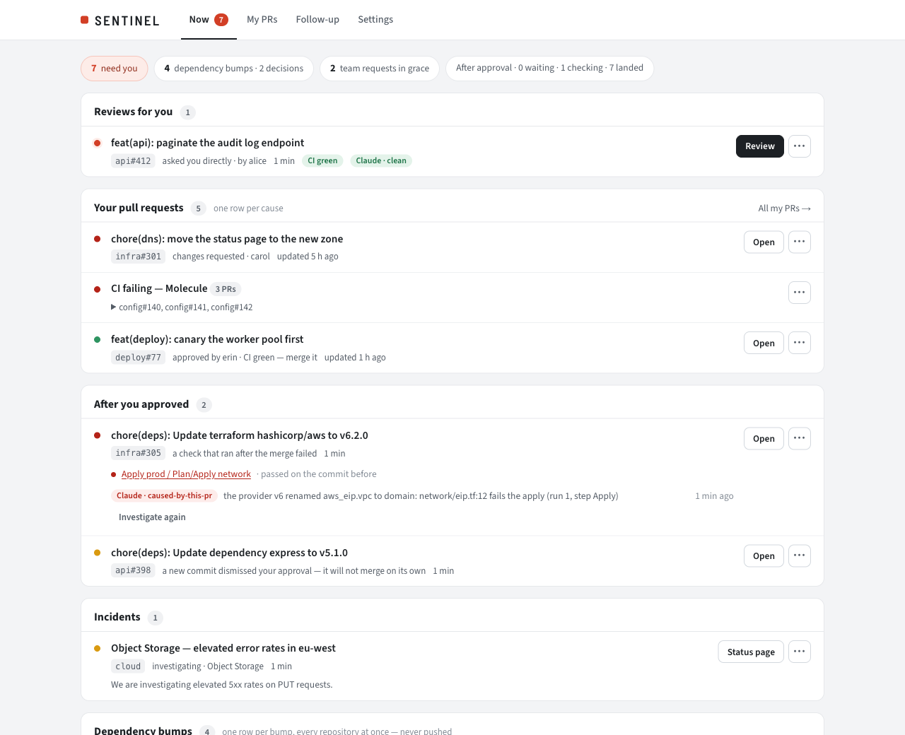

# Sentinel

> A small self-hosted officer of the watch for engineers. It tells you what waits on **you**: review requests, your own pull requests, the ones you approved until they have actually landed, and the provider incidents that touch your infra. Claude reads ahead so you do not have to.




## Why

A review inbox that pushes every request is mostly noise: on a team, most review requests reach you through a team and a teammate takes them within the hour; half of them are dependency bumps; and the PRs you *do* approve vanish from sight — automerge stalls on a dismissed approval, or the merge fails the `terraform apply` that runs afterwards and nobody notices. Sentinel sorts all of this into lanes, interrupts you only for what waits on you, and follows what you approved until it has landed.

## What it does

- **Triage, not a firehose.** Each signal gets a lane and an urgency. A review asked of you by name pushes right away; one asked of your team pushes only if nobody picked it up within a grace period, and disappears once someone approved; dependency bumps never push. More than three at once become a single notification.
- **One inbox, one item at a time.** A list on the left — *Priority* (what waits on you), *Later* (what may wait), *Done* — and the selected item on the right with its actions. `↑` `↓` to move, `E` done, `L` later (back tomorrow 9:00), `⏎` open on GitHub; after an action the next item is selected.
- **Reviews.** The PR on the right: numbered diff, CI checks, reviews, and **Approve**, **Comment** or **Request changes** with a message — line comments and threads stay on GitHub.
- **Dependency bumps, one decision per bump.** Renovate and Dependabot PRs are grouped by `package@version` across repositories, sized from the update table (major / minor / patch), and **Approve the green ones** approves, in one click, the PRs of the bump you were shown — green, and still on the commit whose CI was green. With Claude enabled, each bump is read before you approve it: release notes, a deliberate version pin quietly removed, a failing plan that the bump explains.
- **Your pull requests, by what they wait for.** Conflicts, changes requested, red CI (grouped by failing job: ten PRs red on the same CI job are one problem), approved and green, open threads, nobody asked to review, no movement for days. A PR that starts waiting on you pushes once.
- **Follow-up after you approve.** Every PR you approved (bots by default) is followed until it has *landed*: merged, and every check that ran on the merge commit green — `terraform apply`, deploy, release. A dismissed approval, a PR stuck for days, a post-merge failure or a revert become items. A failing job that already failed in the previous run of its workflow is told apart (*not this PR's doing*), and with Claude enabled a fresh failure is investigated — *caused by this PR*, *unrelated*, or *unclear* — with the root cause from the logs and what to do; one Claude traced elsewhere stops asking for you.
- **Status pages.** Any [Atlassian Statuspage](https://www.atlassian.com/software/statuspage) (Scaleway, OVHcloud, GitHub, Cloudflare…) with component and keyword filters. Incidents and maintenance are listed under *Later*, never pushed.
- **Watch** (optional). The Zabbix problems still open and the Grafana dashboards you keep open, read back every few minutes: a counter that stops, a status that changes, a curve leaving its usual band over the last 30 minutes. A stop or a status change pushes; everything else waits on the Watch page.
- **Health.** A light in the sidebar; sources failing for half an hour (expired token, network down) give one push, however many of them fail.
- **Claude Code sessions, by ticket** (optional, with Claude). Every Claude Code session running on your machine — started here or in any terminal — filed under the ticket it works on, your big rocks first: what waits on you, what works, what sleeps on a big cold context. A session started here is the real CLI in the right pane; a ticket without one is **picked up** by a fresh session that reads the ticket and its last handoff first.
- **Cycle objectives** (optional). Your big rocks from a [Slite](https://slite.com) note joined with their [Shortcut](https://shortcut.com) epics, and a push when one goes quiet for too long.
- **Lookout** (optional, with Claude). A tech watch that keeps a handful of finds a week out of hundreds of links — Hacker News, Lobsters, Reddit, GitHub trending, newsletters and blogs, the releases of the tools you run. Claude reads the titles and keeps the few worth a closer look, reads those (README, page, release notes) and scores them for you, with why each one matters; one push a week. Your feedback — useful, noise, known, to try — goes into the next pass, and **Dig in** reads one find in depth: how mature, what it would change for you, how to try it in 15 minutes.

Everything runs locally in one Docker container with a SQLite file — no account, no cloud, no telemetry. Notifications are native Web Push through your browser; an optional [Claude Code](https://claude.com/claude-code) mod puts the same inbox in your terminal's status line.

## Quick start

```bash
git clone https://github.com/vgazelot/sentinel.git && cd sentinel

# 1. Configuration: your GitHub login/orgs and the status pages you care about
cp config.example.yaml config.yaml

# 2. Secrets: a GitHub token (quick bootstrap: gh auth token)
cp .env.example .env

# 3. Web Push (VAPID) keys, pasted into .env
docker compose build
docker compose run --rm sentinel python gen_vapid.py

# 4. Run
docker compose up -d
```

Open **http://localhost:8300**, then **Settings → Subscribe this browser** (use `localhost`, not `127.0.0.1`: the service worker origin depends on it).

> [!WARNING]
> Sentinel has **no authentication**. It is designed to run on your own machine, bound to `127.0.0.1` (the default in `docker-compose.yml`). Never expose it to a network.

## When Sentinel interrupts you

| Signal | Shown in | Pushed |
|---|---|---|
| Review asked of you by name | For you | right away |
| Review asked of a team you belong to | Later → For you | only if still unclaimed after `team_grace_minutes`; gone once somebody approved |
| Dependency bump (bot PR) | Later | never — grouped by bump |
| Your PR starts waiting on you | Your pull requests | once per transition (conflicts, changes requested, red CI, open threads); approved and green: never |
| A PR you approved: approval dismissed, stuck, broken after merge, reverted | For you | once |
| Provider incident on your components | Later | never |
| Zabbix problem at `push_severity` or above; a dashboard counter that stops or a status that changes (two reads in a row) | Monitoring | right away |
| Sentinel cannot reach a source | the sidebar light | once, after `health_minutes`, however many sources |
| A big rock stalls (Cycle) | Cycle tab | once |
| Lookout finds scored at or above `threshold` | Lookout tab | one push a week (`digest`, Monday 9:00 by default), never one per find |

Every item can be marked **Done** (out of the inbox until it changes) or sent to **Later** (back tomorrow at 9:00). An item that leaves its source (PR merged, incident resolved) resolves itself. The first pass of a new source records what is already there without pushing it.

## Configuration

`config.yaml` (mounted read-only — `docker compose restart` after editing). See [config.example.yaml](config.example.yaml) for every option.

```yaml
watchers:
  github_reviews:
    enabled: true
    interval_seconds: 180
    login: your-github-username
    orgs: [your-org]
  statuspage:
    enabled: true
    interval_seconds: 300
    instances:
      - name: scaleway
        url: https://status.scaleway.com/api/v2/summary.json
        components: [Instances, Object Storage]   # an affected component must match (substring)
        keywords: []                               # extra AND filter, matched at word start
        include_maintenances: true                 # listed, never pushed

followup:                         # the PRs you approved, until they have landed
  enabled: true
  authors: [renovate, dependabot] # bots whose PRs merge without their author watching; `all` = everything you approve
  stale_days: 3
  window_days: 7

triage:                           # defaults shown
  team_grace_minutes: 60
  health_minutes: 30
  stale_review_days: 3

agents:                           # Claude, see below; defaults shown
  precheck: true
  followup: true
  max_runs_per_day: 30
  concurrency: 2
```

Environment variables (`.env`):

| Variable | Purpose |
|---|---|
| `GITHUB_TOKEN` | Reads PRs, reviews and checks. **Approve** needs a token allowed to review (classic PAT with `repo`, or fine-grained with Pull requests: write) |
| `VAPID_PRIVATE_KEY` / `VAPID_PUBLIC_KEY` | Web Push keys — `docker compose run --rm sentinel python gen_vapid.py` |
| `VAPID_CLAIM_EMAIL` | Contact address embedded in push claims |
| `TZ` | Timezone for display and "snooze until tomorrow 9:00" (default `UTC`) |
| `CLAUDE_BRIDGE_URL` | Optional — the host-side [Claude bridge](#claude-optional), e.g. `http://host.docker.internal:8301` |
| `SLITE_API_KEY` / `SHORTCUT_API_TOKEN` | Optional — the Cycle tab |
| `SENTINEL_PUSH_DISABLED` | `1` = never push (a second instance on a copy of the database) |

## Claude (optional)

Claude Code runs on the **host** — that is where your skills, repositories and `gh` login live — so `contrib/claude-bridge/` is a stdlib-only HTTP server the container calls on `127.0.0.1:8301`. It runs `claude -p` in one of nine modes; the bridge owns prompts, models and tools, the app only sends PR URLs (or a Lookout find's link) and a little context.

| Mode | When | What |
|---|---|---|
| `deep` | on demand, from a review of a PR written by a person | devil's advocate review, reading the repositories (subagents, default model) |
| `precheck` | automatic, each pending dependency bump | release notes, removed pins, failing checks the bump explains → `safe` / `check` / `risky` (`sonnet`) |
| `brief` | automatic, each review asked of you (once per commit) | what it changes and how carefully to read it → `trivial` / `routine` / `careful`, shown on the row (`sonnet`) |
| `whyred` | automatic, your PRs red on the same CI job (once per set of heads) | the failed job logs → `fix-in-pr` / `flaky` / `elsewhere` / `unclear`, the key log line and what to do |
| `asks` | automatic, your PRs with changes requested or open threads | the reviewers' comments as a `file:line` to-do (`sonnet`) |
| `followup` | automatic, a fresh post-merge failure of a PR you approved | the failed run's logs, the history of the same workflow → `caused-by-this-pr` / `unrelated` / `unclear` and what to do |
| `scout` | automatic, Lookout, at most every `scout_hours` | the new titles at once → the few worth a closer look, with a reason (`sonnet`) |
| `assess` | automatic, Lookout, as soon as finds are kept | a few kept finds with their README, page or release notes → score, `try` / `watch` / `skip`, why it matters to you |
| `dig` | on demand, on a Lookout find | one find in depth → `adopt` / `trial` / `assess` / `hold`, maturity, fit with your stack, how to try it |

A follow-up investigation answers with a push. A failure Claude traced to something else stops asking for you — unless a fact Claude could not argue with says otherwise: the failing job passed right before the merge, its log could not be read, or it failed after the investigation (which then runs again). Automatic runs are capped per day (`agents.max_runs_per_day`) and run at most `agents.concurrency` at a time.

**What Claude can touch.**
- **Every automatic mode (`precheck`, `followup`, `brief`, `whyred`, `asks`, `scout`, `assess`) and `dig` get no tool at all.** They read third-party text (a diff, release notes, CI logs, web pages), so Sentinel fetches the material itself — the PR and its diff, the failed job logs, the recent runs of the failing workflow, a README or an article — and Claude only reads it, fenced as untrusted data. A text written to steer the model can bend a verdict; it cannot read a file or reach a host. The Lookout's `profile` — your own words, from `config.yaml` — is the only text sent outside the fence.
- **`deep`** explores the repositories with named read-only commands (`gh pr view/diff/checks`, `gh run view`, `git log/show`, `git fetch origin`, `grep`…): no `gh api` (with `-f` it is a POST, and `-X` can follow any prefix, so no rule tells a read from a merge), no WebFetch, and its Read tool refuses `.env`, `.mcp.json`, keys and `~/.ssh`, `~/.aws`, `~/.config`. It is offered only on PRs written by people, never on a bot's. What remains possible to a PR crafted against it: read a file through a shell and leak it in a `gh … -R <host>` lookup — a review you start yourself, on a colleague's PR.
- Every run loads your *user* settings only (`--setting-sources user`): the allow rules of the project the bridge starts in would otherwise add to the bridge's lists (an allowed `tee` there wrote a file in a run meant to be read-only). No MCP servers.
- The bridge answers local hosts only (no DNS rebinding) and runs nothing without `BRIDGE_TOKEN` — set on it, and the same value as `CLAUDE_BRIDGE_TOKEN` in Sentinel's `.env` — so only Sentinel can make it run Claude, not a page your browser opens.

```bash
# 1. the bridge, kept alive by launchd (edit the plist: python3, claude binary, workspace dir)
cp contrib/claude-bridge/com.example.sentinel-claude-bridge.plist ~/Library/LaunchAgents/
launchctl load ~/Library/LaunchAgents/com.example.sentinel-claude-bridge.plist
curl http://127.0.0.1:8301/healthz

# 2. the app, with the token the plist sets as BRIDGE_TOKEN (python3 -c "import secrets; print(secrets.token_urlsafe(32))")
echo CLAUDE_BRIDGE_URL=http://host.docker.internal:8301 >> .env
echo CLAUDE_BRIDGE_TOKEN=<the same token> >> .env && docker compose up -d
```

The bridge is a separate process: after pulling a new version, restart it too (`launchctl bootout` then `bootstrap` the plist) — Settings and a health item tell you when Sentinel talks to an older bridge.

Bridge environment: `BRIDGE_TOKEN`, `BRIDGE_LANG` (answer language, default English), `BRIDGE_PROMPT` / `BRIDGE_PROMPT_<MODE>` (replace a mode's prompt — placeholders `{url}`, `{urls}`, `{context}`, `{lang}`, `{profile}`; point them at your own skills, e.g. `/my-review {url}`), `BRIDGE_MODEL` / `BRIDGE_MODEL_<MODE>`, `BRIDGE_CWD` (where Claude starts: its `CLAUDE.md` and skills apply). After editing the plist, `launchctl bootout` then `bootstrap` it — `kickstart -k` keeps the old environment.

## Claude console (optional)

A live Claude Code session — the real CLI in a terminal ([xterm.js](https://xtermjs.org/), loaded from a CDN with SRI on first use), not a chat. The Claude button of a Zabbix problem starts one, told to open a ticket for the problem (or reuse the open one) and to investigate read-only until you say otherwise, and takes you to [Sessions](#sessions-optional): it opens on the board beside the active terminal, filed under the run with the other run sessions; then you talk to it as in any terminal. Change what it is told with `claude_prompt` in the `zabbix:` block (`{name}`, `{host}`, `{severity}`, `{since}`, `{age}`, `{url}`).

- **Where it runs.** The bridge starts it on the host, in a session of its own tmux server (`brew install tmux`), with `claude` in your login shell from `BRIDGE_CWD`: your PATH, ssh agent, skills and permissions, as in a terminal. Read-only is an instruction, not a fence: once you have read, you act in the same session.
- **It outlives the page.** Leave it, take it off the board: the session goes on, and the same button (marked with a dot while it runs) brings it back. **End** stops it. Settings lists the consoles still running, to reopen one whose alert is gone — in a window over the page, which you drag by its head. From any terminal: `tmux -L sentinel ls`, `tmux -L sentinel attach -t zabbix-<event>`.
- **Who can attach.** The browser cannot send the bridge token, so the bridge hands Sentinel a ticket valid once and for one minute, and accepts the WebSocket only from `BRIDGE_ORIGINS` (default `http://localhost:8300,http://127.0.0.1:8300`). Another page can neither open a console (Sentinel refuses cross-site POSTs) nor attach to one, nor show Sentinel in a frame to borrow your clicks and keys (`X-Frame-Options: DENY`). The page only names the alert: Sentinel writes the prompt — each field from Zabbix cut to one short printable line, and called data, not instructions, since a problem name can carry an item's value — and the shell receives it through an environment variable, never as code.
- Bridge environment: `BRIDGE_CONSOLE_COMMAND` (default `claude`), `BRIDGE_ORIGINS`, `TMUX_BIN`; Sentinel's `CLAUDE_CONSOLE_URL` when the browser reaches the bridge elsewhere than `ws://localhost:<port of CLAUDE_BRIDGE_URL>`. In the terminal, ⌥-drag selects text, the wheel scrolls back.

## Sessions (optional)

The Claude Code sessions running on your machine, filed under the tickets they work on: your big rocks, then the run, then what runs off the cycle. Needs the Claude bridge (it reads the sessions on the host) and, for the tickets, the [Cycle tab](#cycle-tab-optional).

- **What a row says.** *waits for you* (a question or a permission), *working*, *answered* (its turn is over, the prompt cache still warm), *idle* (cache cold) — with the context size when starting fresh would be cheaper: an hour after its last answer, the next message writes the whole context to the cache again. Your started tickets without a session follow, one line each, their state drawn by the icon (backlog, to do, started, in review, blocked); the ones not started yet fold under them. Each big rock is a block you can fold; **Live** shows only the sessions. Drag a session onto another block to file it there — the run, a big rock, off cycle, or a section of yours (**+ New section**, or drop it there to make one; rename and remove from its header): where you put it wins over its ticket. **New** asks where the session goes, the run by default.
- **Focus.** Click a session (or ⏎ on it) to work in it: the sidebar folds into a rail (hover it to open it), the list keeps only the live sessions — or folds into a column of their icons (`⌥0`). Esc goes back to every ticket.
- **Side by side.** Up to four sessions on the board: drag one from the list onto a terminal to split it (left or right half, then top or bottom of a column) — the box under the pointer says where it lands; drag a terminal's head onto another to swap them, onto the list (or its ×) to take it off, the session goes on. Selecting a session puts it in the active terminal's place; each row shows where its terminal is. `⌥1`…`⌥4` gives a terminal the keys, even from inside another one. The board is remembered by the browser.
- **Where it comes from.** `claude agents --json` (Claude Code's list of running sessions) through the bridge, each session's title from its transcript, and — for its ticket, its context size and the advice — what the [context advisor](#claude-code-context-advisor-optional) publishes about it: Sentinel shows the advisor's own figures, it never works them out again. A session started before the advisor was loaded lists without ticket or size.
- **Consoles.** A session started here — **Pick up** on a ticket, **New** for anything else — runs in a console: the real CLI, on the board, running on when you leave (`tmux -L sentinel attach -t sc-12345` from a terminal). One started in another terminal is listed with its name (`dev-9a`), read-only. **Pick up** starts a fresh session linked to the ticket and told to read it and its last handoff first — `resume_prompt` in a `sessions:` block changes what it is told (`{story}`). **Start fresh** types the advisor's handoff command, Enter is yours: the session writes where it stands into the ticket, then a fresh one picks up from there.

## Claude Code status line (optional)

`contrib/claude-code-mod/` is a [Claude Code](https://claude.com/claude-code) mod that reads `GET /api/summary`: the status line shows what needs you (`● 3 for you · 2 bumps · landing 1 failed`), new notifications appear as toasts, and `/sentinel` opens the inbox in a pane — open, done, later, and a devil's advocate review run right in your session. It only reads Sentinel's API: one source of truth, no second poller.

## Claude Code context advisor (optional)

`contrib/claude-code-context/` is a [Claude Code](https://claude.com/claude-code) mod that keeps a session's context in view and its work in the ticket: the status line shows the context size, a cold prompt cache and the 5-hour quota; a message about to re-read a big context whose cache expired is held once with its price (Enter sends it anyway); past `CONTEXT_HANDOFF_TOKENS` (350k) it offers `/handoff`, which has the session write where it stands into the linked Shortcut story, then clears and starts a fresh session from that story. `/fresh` starts fresh from the story right away, `/ticket sc-12345` links one (detected otherwise from what you type, Shortcut tools and git commands), `/budget` shows the figures. When the session loaded a project with `/load-project` or `/resume-project` (a project-memory plugin keeping a project's summary, decisions and `handoff.md`), `/handoff` also updates that memory and its `handoff.md` without asking, pushes nothing, and the fresh session starts with `/resume-project`. It also writes what its status line shows to `~/.claude/context-advisor/<session id>.json` for [Sessions](#sessions-optional), links a session started with `CONTEXT_STORY=sc-12345` to that story, and gives a session back its story when it is resumed or the mod reloads. A command name another plugin already holds is left to it — `/handoff` then becomes `/context-handoff` — and a toast says so. Load it with `--plugin-dir contrib/claude-code-context` or `CLAUDE_CODE_PLUGIN_DIRS`.

## Cycle tab (optional)

Hidden unless `SLITE_API_KEY` and `SHORTCUT_API_TOKEN` are in `.env` *and* `config.yaml` has a `cycle:` block. Objectives come from the Slite note, live progress from Shortcut, and the tab rolls over to the next cycle by itself: newest note under `parent_id`, dates read off its title, highest `<prefix>-<year>-C<n>` label, epics carrying that label whose name contains the big rock title. Each big rock gets a verdict — stalled, behind, on track — measured on the note's outputs, not on story progress (epics carry stories closed in earlier cycles). See the `cycle:` block of [config.example.yaml](config.example.yaml).

## Watch (optional)

Hidden unless `config.yaml` has a `zabbix:` or `grafana:` block under `watchers` — see [config.example.yaml](config.example.yaml). Dashboards are given as the links you open them with: the link's variables are used, the dashboard's saved values fill the rest; each one is its own source, and the token only goes to the Grafana named in `url`. Tokens go in `.env` (`ZABBIX_TOKEN`, `GRAFANA_TOKEN`, read-only is enough); a client certificate for an mTLS proxy goes in the folder `SENTINEL_CERTS` points to, mounted on `/certs`.

**Claude on a Zabbix problem.** With `claude: true` in the `zabbix:` block and the Claude bridge set up, every problem on the Watch page (and a Zabbix alert's detail in the inbox) gets a **Claude** button: it opens a console in Sessions — see [Claude console](#claude-console-optional).

## Lookout (optional)

Hidden unless `config.yaml` has a `lookout:` block with `enabled: true` and Claude is set up (the bridge does the reading). Every `collect_minutes` the sources are read into one row per thing — the same repository on Hacker News, in a newsletter and on GitHub trending is one row with three mentions. Then two passes of Claude:

1. **Scout** — every new title at once, with where it was seen and its points, against your `profile`: Claude keeps the few you would regret missing (usually one in ten or fewer). At most every `scout_hours`.
2. **Assess** — the kept ones, a few at a time, with their material: the README, age, activity, contributors and license of a repository; the text of an article; the notes of a release. Each gets a score out of 10, `try` / `watch` / `skip`, a category and why it matters to you. What scores `threshold` or more shows on the page.

Releases of the tools you list skip the scout: a new minor or major version, or a patch that fixes a vulnerability. Your feedback (**Useful**, **Noise**, **Known**, **To try**) is sent with both passes, and **Filtered out** shows what the filter left out last week so you can tell it **Should have kept**. One push a week (`digest`) names the finds of the week; nothing else pushes. Sources that fail are listed at the bottom of the page — never a health item: a feed down for a day costs a few links. Rows without feedback are forgotten after `keep_days`.

Sources (see the `lookout:` block of [config.example.yaml](config.example.yaml)): `hackernews` (Algolia search, stories past `min_points`), `lobsters` (tags), `reddit` (top of the week, as RSS), `github_trending` (through [a public RSS mirror](https://github.com/mshibanami/GitHubTrendingRSS) of the trending page — GitHub has no API for it), `feeds` (any RSS/Atom; `expand: true` reads a newsletter issue as the links it shares), `releases` (GitHub repositories). Pages are read from public addresses only, every redirect checked again, and only http(s) links are kept.

A pass is an automatic run: it counts in `agents.max_runs_per_day`. A first start reads a few days of backlog — two scouts and a few assessments — then it settles at a scout or two a day and an assessment per batch of kept finds.

## Fallback notifier (macOS, optional)

Web Push only works while a subscribed browser runs. `contrib/host-notifier/` is a launchd agent that polls the API and relays notifications through [`terminal-notifier`](https://formulae.brew.sh/formula/terminal-notifier):

```bash
brew install terminal-notifier
# edit the plist first: replace /path/to/sentinel with your clone path
cp contrib/host-notifier/com.example.sentinel-notifier.plist ~/Library/LaunchAgents/
launchctl load ~/Library/LaunchAgents/com.example.sentinel-notifier.plist
```

## Tests

```bash
docker build -t sentinel-dev ./app
docker run --rm -v "$PWD/app:/app" -v "$PWD/tests:/tests" -v "$PWD/contrib:/contrib" -w /app sentinel-dev python -m unittest discover -s /tests
```

## Architecture

Flask 3 + APScheduler (in-process, hence the single gunicorn worker) + SQLite (WAL) + HTMX, no build step. A watcher is one class whose `fetch()` returns the current state as items with a lane and an urgency; `engine.py` diffs it against the stored state and owns the notification policy (urgency, grace period, bursts, ack/snooze). Your PRs, the follow-up of what you approved and Cycle compute their own state and feed the same engine. See [CLAUDE.md](CLAUDE.md) for the full tour.

## License

[MIT](LICENSE)
